# 미리내 마당 구조 정리

티켓 예매 서비스 미리내 마당이 어떻게 만들어져 있는지 그림으로 정리했다. 바깥(컨테이너)에서 안쪽(코드, 데이터, 요청 흐름)으로 들어가는 순서다. 기준은 `next` 브랜치의 2026-11-25 상태다.

GitHub에서 열면 그림이 그려진다. 그림의 원본은 아래 코드 블록(mermaid)이다.

## 차례

1. [전체 구성](#1-전체-구성) (구성도)
2. [띄우는 순서](#2-띄우는-순서) (의존 관계도)
3. [이미지를 만드는 과정](#3-이미지를-만드는-과정) (빌드 흐름도)
4. [요청 하나가 지나는 길](#4-요청-하나가-지나는-길) (계층도)
5. [데이터 구조](#5-데이터-구조) (ERD)
6. [상태를 어디에 두는가](#6-상태를-어디에-두는가) (배치도)
7. [화면 흐름](#7-화면-흐름) (화면 흐름도)
8. [로그인](#8-로그인) (시퀀스)
9. [예매](#9-예매) (시퀀스)
10. [상태 변화](#10-상태-변화) (상태도)
11. [Redis에 문제가 생겼을 때](#11-redis에-문제가-생겼을-때) (판단 흐름도)
12. [시드 데이터가 들어가는 과정](#12-시드-데이터가-들어가는-과정) (처리 흐름도)
13. [쿠버네티스에 올릴 때](#13-쿠버네티스에-올릴-때) (배포 구성도)
14. [만든 방식](#14-만든-방식) (작업 흐름도)
15. [고른 것과 이유](#15-고른-것과-이유) (표)
16. [어디를 읽으면 되나](#16-어디를-읽으면-되나) (표)

## 1. 전체 구성

컨테이너는 다섯 종류다. 브라우저가 만나는 것은 frontend 하나이고, frontend의 nginx가 화면 파일을 직접 주면서 `/api/`로 시작하는 요청만 backend로 넘긴다.

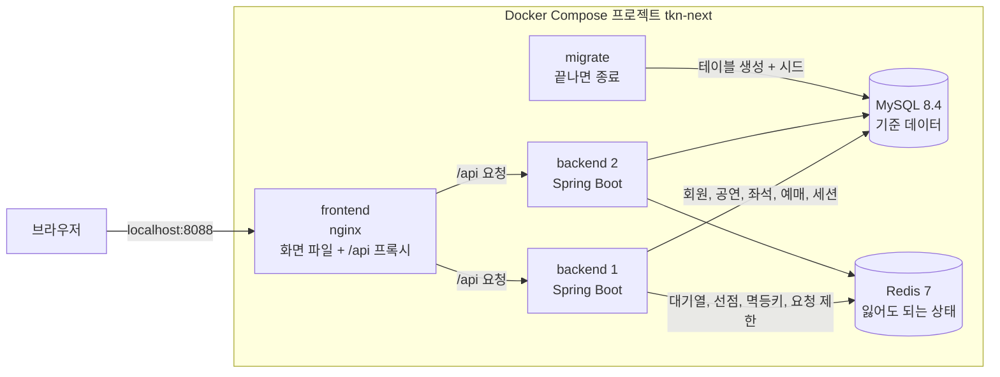

backend는 두 개가 같은 MySQL과 Redis를 본다. 서버 메모리에 사용자 상태를 두지 않아서 몇 개로 늘려도 동작이 같다.

| 구성요소 | 기술 | 하는 일 |
|---|---|---|
| frontend | React, Vite, TypeScript. nginx-unprivileged로 서빙 | 화면 파일, 포스터와 배너 그림, `/api` 프록시, gzip, 보안 헤더 |
| backend | Java 21, Spring Boot 3, JdbcClient | API. 상태 없음. 2개 실행 |
| migrate | backend와 같은 이미지를 `migrate` 인자로 실행 | Flyway로 테이블을 만들고 시드 데이터를 넣은 뒤 종료 |
| MySQL 8.4 |  | 회원, 공연, 회차, 좌석, 예매, 로그인 세션, 배너, 공지 |
| Redis 7 | 저장 끔(`appendonly no`) | 접속 대기열, 좌석 임시 선점, 멱등키, 요청 제한 |

## 2. 띄우는 순서

`compose.yaml`의 `depends_on`이 순서를 정한다. 앞 단계가 준비됐다고 확인돼야 다음이 시작한다.

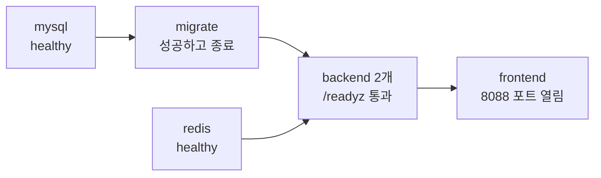

migrate가 실패하면 backend는 뜨지 않는다. frontend는 backend가 healthy가 된 뒤에 뜬다(nginx가 시작할 때 backend 이름을 찾기 때문).

- 테이블 변경과 시드를 서버 시작과 분리했다. backend가 여러 개 동시에 떠도 스키마를 건드리는 것은 migrate 하나뿐이다. 쿠버네티스에서는 이것이 Job이 된다.
- DB 계정도 둘로 나눴다. migrate는 스키마 소유자 `ticketing`으로, backend는 권한이 좁은 `ticketing_app`으로 접속한다. backend 계정은 예매, 좌석, 회원 테이블을 지울 수 없다.
- 비밀번호는 `compose.yaml`에 없다. 같은 폴더의 `.env`에서 읽고, `.env`는 저장소에 올리지 않는다.

## 3. 이미지를 만드는 과정

두 이미지 모두 여러 단계로 빌드한다. 빌드 도구는 앞 단계에만 있고 실행 이미지에는 결과물만 들어간다.

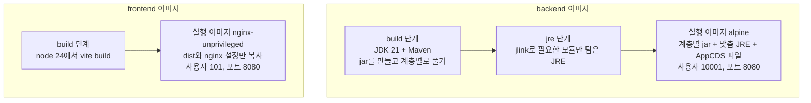

backend는 jar를 의존성, 로더, 애플리케이션 계층으로 나눠 복사한다. 코드만 바꾸면 마지막 계층만 다시 만들어진다.

- 두 이미지 모두 root가 아닌 사용자로 실행한다.
- backend는 `MaxRAMPercentage=75`로 컨테이너 메모리 한도에 맞춰 힙을 잡고, AppCDS 보관 파일로 시작 시간을 줄인다.
- frontend 빌드 때 `public/posters`에 그림이 있는 공연 번호 목록을 만들어 번들에 넣는다. 그림이 없는 공연은 화면이 포스터를 직접 그린다.

## 4. 요청 하나가 지나는 길

backend 안에서는 필터를 차례로 지난 뒤 컨트롤러, 서비스, 저장소 순서로 내려간다. 각 계층은 바로 아래 계층의 인터페이스만 안다.

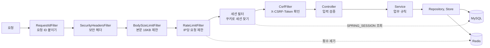

요청 제한이 세션 조회보다 앞에 있다. 몰려드는 요청은 DB에 닿기 전에 걸러진다.

| 패키지 | 맡은 일 | 먼저 읽을 파일 |
|---|---|---|
| `show` | 공연 목록, 상세, 랭킹, 판매 상태 계산 | `ShowService.java`, `SaleStatus.java` |
| `queue` | 접속 대기열 | `QueueService.java`, `resources/redis/queue-*.lua` |
| `seat` | 좌석 조회, 임시 선점 | `SeatService.java`, `resources/redis/hold-create.lua` |
| `reservation` | 예매 확정, 내 예매, 취소 | `ReservationService.java` |
| `auth` | 가입, 로그인, 세션, CSRF | `AuthService.java`, `SessionConfig.java`, `CsrfFilter.java` |
| `content` | 배너, 공지 | `ContentService.java` |
| `ratelimit`, `web` | 요청 제한, 공통 필터 | `RateLimitFilter.java` |
| `migrate` | 시드 데이터 | `Seeder.java`, `AddedShows.java`, `ContentSeed.java` |
| `health` | `/healthz`, `/readyz` | `ReadinessService.java` |

## 5. 데이터 구조

중심은 공연, 회차, 좌석이다. 공연 하나에 회차가 여러 개 있고, 좌석은 회차마다 따로 만든다. 그래서 같은 자리라도 회차가 다르면 다른 행이다.

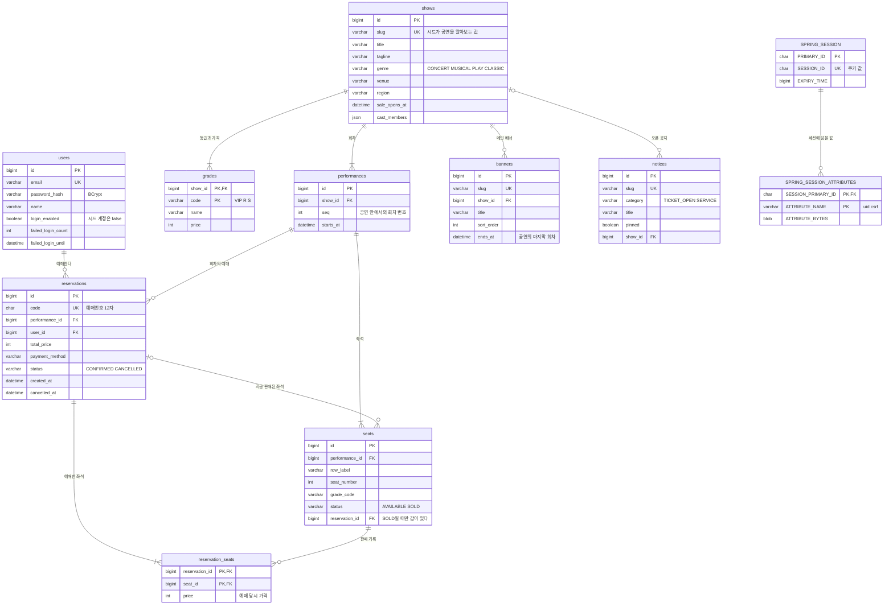

주요 열만 적었다. 전체는 backend/src/main/resources/db/migration의 V1~V5에 있다.

중복 판매를 DB가 막는 장치가 세 가지 들어 있다.

- `seats`의 유니크 키 `(performance_id, row_label, seat_number)`: 같은 회차에 같은 자리가 두 번 생기지 않는다.
- `seats`의 CHECK: 상태가 `SOLD`인 것과 `reservation_id`가 있는 것이 항상 같아야 한다.
- 예매 확정의 `UPDATE seats ... WHERE status = 'AVAILABLE'`: 바뀐 행 수가 고른 좌석 수와 다르면 트랜잭션을 되돌린다.

`reservation_seats`를 따로 둔 이유는 기록 때문이다. 취소하면 `seats.reservation_id`는 비워지지만 어떤 예매가 어떤 좌석을 얼마에 샀는지는 남는다.

## 6. 상태를 어디에 두는가

상태를 잃으면 안 되는 것과 잃어도 되는 것으로 나눴다. 나중에 여러 클라우드에 올릴 때 클라우드 사이에 복제하는 저장소는 MySQL 하나이고, Redis는 클라우드마다 따로 두며 넘어가면 빈 상태로 시작한다.

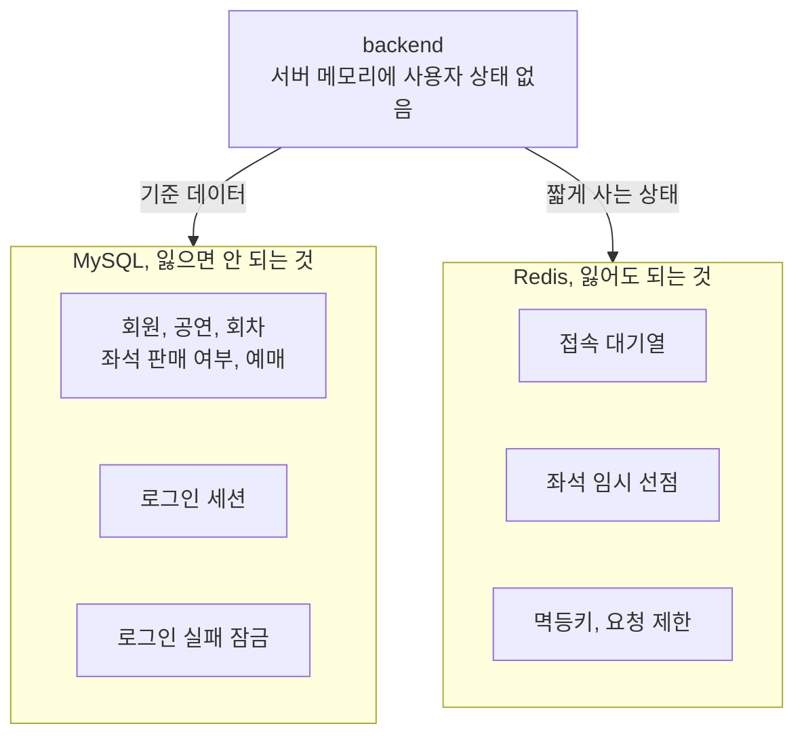

Redis에 있는 것은 모두 TTL이 있고, 사라져도 사용자가 다시 줄을 서거나 좌석을 다시 고르면 된다.

| Redis 키 | 종류 | 내용 |
|---|---|---|
| `queue:{회차}:waiting` | ZSET | 기다리는 사람. 점수는 줄 선 순서 |
| `queue:{회차}:active` | ZSET | 입장한 사람. 점수는 입장 권한이 끝나는 시각 |
| `queue:{회차}:user:{사용자}` | STRING | 이 사용자가 이 회차에서 가진 토큰. 한 사람에 하나 |
| `queue:token:{토큰}` | HASH | 토큰의 회차, 사용자, 선점 번호 |
| `hold:{선점}` | HASH | 선점의 토큰, 회차, 좌석 목록, 합계, 만료 시각 |
| `seat:hold:{회차}:{좌석}` | STRING | 이 좌석을 잡은 선점 번호. TTL이 선점 시간 |

## 7. 화면 흐름

화면 주소는 `frontend/src/App.tsx`에 모여 있다. 예매 화면 세 개와 내 예매는 로그인해야 들어갈 수 있다.

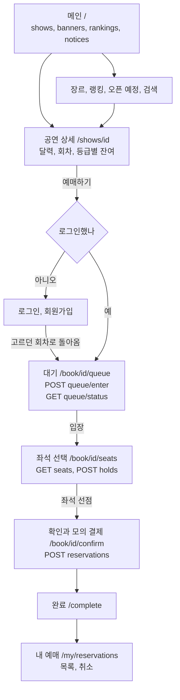

대기 화면은 자리가 있으면 바로 좌석 선택으로 넘어간다. 동시에 들어갈 수 있는 인원은 회차마다 QUEUE_MAX_ACTIVE(기본 100)다.

## 8. 로그인

브라우저가 가진 것은 세션 번호가 든 쿠키뿐이다. 로그인 정보는 MySQL의 `SPRING_SESSION`에 있다.

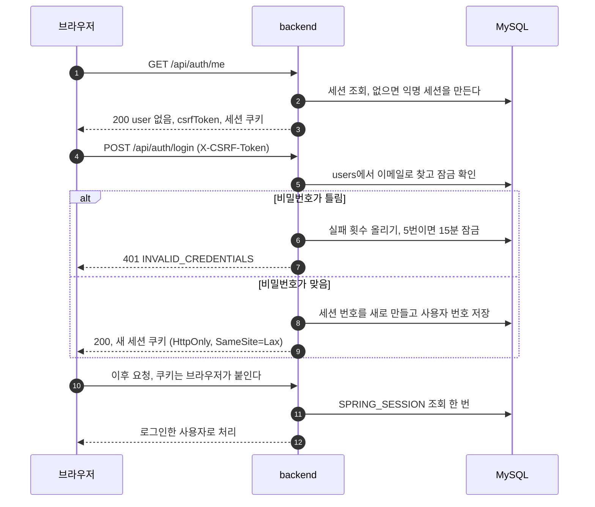

로그인에 성공하면 세션 번호를 새로 만든다. 로그인 전에 받은 번호를 누가 알고 있어도 쓸 수 없다.

- JWT 대신 서버 세션을 썼다. 로그아웃하면 서버에서 바로 지울 수 있고, 브라우저 저장소에 토큰을 두지 않아도 된다.
- 세션을 MySQL에 뒀기 때문에 backend가 여러 개여도 어느 쪽으로 요청이 가든 로그인이 유지되고, Redis가 비워져도 로그아웃되지 않는다.
- 응답은 이메일이 없는 경우와 비밀번호가 틀린 경우를 구분하지 않는다. 없는 이메일의 실패 횟수는 Redis에서 센다.
- 상태를 바꾸는 요청은 모두 `X-CSRF-Token` 헤더가 세션에 저장한 값과 같아야 한다.

## 9. 예매

예매는 대기열, 좌석 조회, 임시 선점, 확정의 네 단계다. 앞의 세 단계는 Redis가, 마지막 확정은 MySQL이 판단한다.

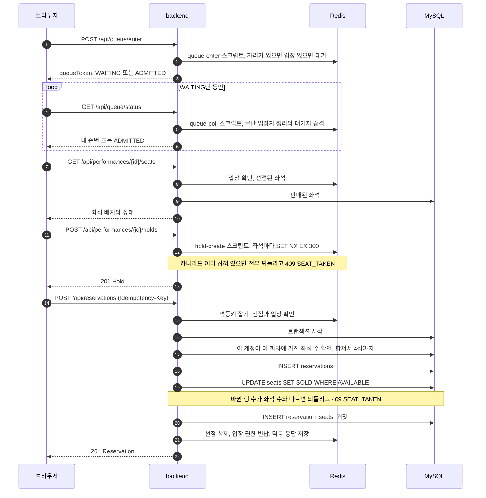

Redis 스크립트는 한 번에 끝까지 실행된다. 두 사람이 같은 좌석을 동시에 눌러도 한 사람만 선점한다.

- 선점은 전부 아니면 전무다. 네 좌석 중 하나라도 남이 잡았으면 네 좌석 모두 잡지 않는다.
- 선점은 300초 뒤 Redis의 TTL로 저절로 풀린다. 정리하는 작업을 따로 돌리지 않는다.
- 확정 요청이 두 번 가도 예매는 한 건이다. 같은 `Idempotency-Key`의 두 번째 요청은 처음 응답을 그대로 받는다.
- Redis가 틀린 답을 줘도 판매는 한 번만 된다. 마지막 `UPDATE`의 조건이 DB에서 한 번 더 막는다.
- 커밋한 뒤의 Redis 정리가 실패해도 예매는 유효하다. 남은 키는 TTL로 사라진다.

## 10. 상태 변화

**좌석.** 판매 여부는 MySQL에, 임시 선점은 Redis에 있다. 화면에 보이는 좌석 상태는 둘을 합친 것이다.

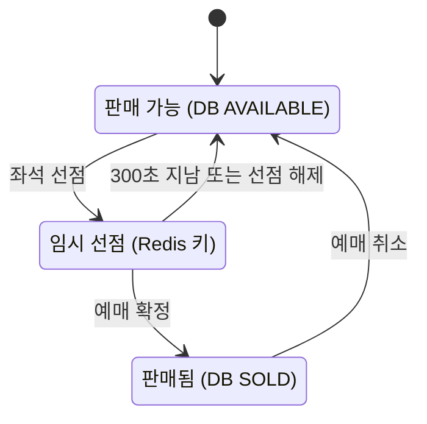

임시 선점 상태는 DB에 기록하지 않는다. Redis가 비워지면 선점만 사라지고 판매된 좌석은 그대로다.

**대기열 토큰.** 회차마다 한 사람이 토큰 하나를 가진다.

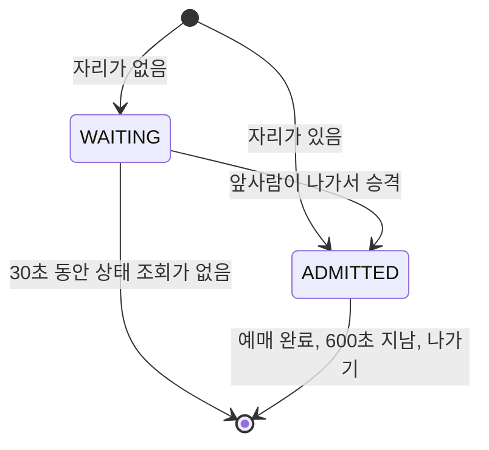

승격은 누군가 상태를 조회할 때 스크립트 안에서 일어난다. 주기적으로 도는 작업이 없어서 서버가 몇 대여도 결과가 같다.

**판매 상태.** DB에 저장하지 않고 요청을 받을 때마다 시각과 남은 좌석으로 계산한다.

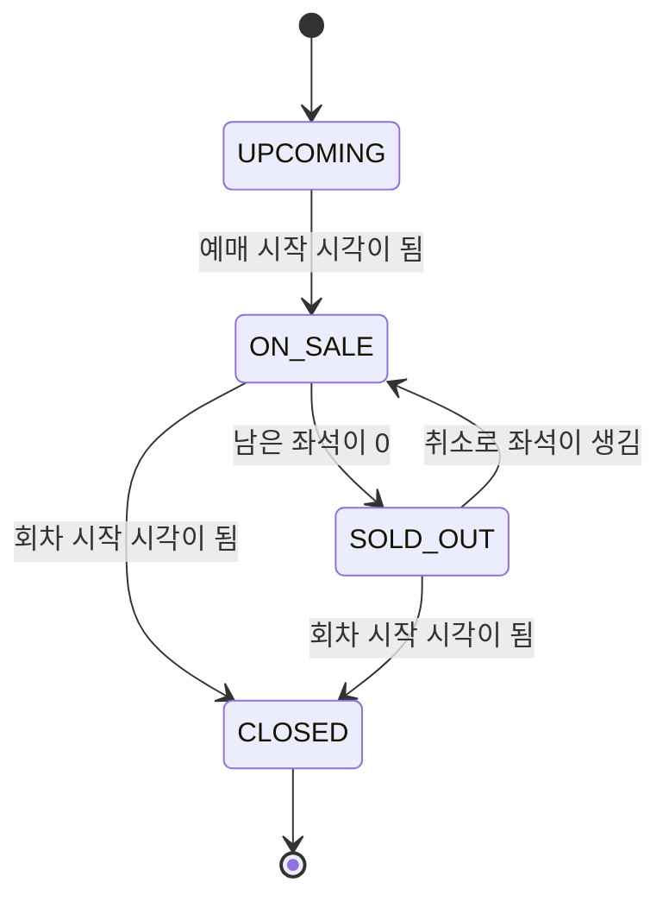

회차의 상태다. 공연의 상태는 회차들로 정한다. 모든 회차가 CLOSED면 공연도 CLOSED이고 화면에는 판매 종료로 나온다.

## 11. Redis에 문제가 생겼을 때

Redis가 죽거나 비워져도 둘러보기와 로그인은 계속된다. 예매 진행만 닫거나 다시 시작하게 한다.

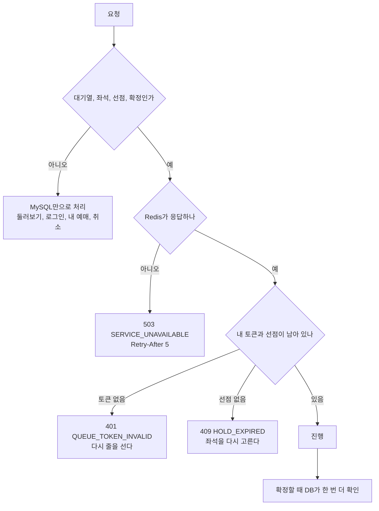

Redis가 죽었을 때 대기열 없이 통과시키지 않는다. 줄 선 순서가 무너지고 가장 몰리는 순간에 DB가 부하를 그대로 받기 때문이다.

| 상황 | 둘러보기, 로그인, 내 예매 | 대기열 | 좌석, 선점 | 예매 확정 | `/readyz` |
|---|---|---|---|---|---|
| 비워졌다 | 정상 | 401, 다시 진입 | 옛 토큰 401. 팔린 좌석은 409 | 선점 중이었으면 409 `HOLD_EXPIRED` | 200 |
| 죽어 있다 | 정상 | 503 | 503 | 503 | 200, `redis: down` |
| 다시 살아났다 | 정상 | 재시작 없이 정상 | 정상 | 정상 | 200, `redis: up` |

`/readyz`는 MySQL 연결만 본다. Redis가 죽었다고 backend가 트래픽에서 빠지면 둘러보기까지 멈추기 때문이다. 이 동작은 통합 테스트 `RedisLossIT`, `RedisDownIT`, `RedisPauseIT`와 `docs/next/INTEGRATION.md`의 확인 기록에 있다.

## 12. 시드 데이터가 들어가는 과정

공연 68개, 회차 262개, 좌석 39,308석은 migrate가 넣는다. 여러 번 돌려도 같은 결과가 되도록 만들었다.

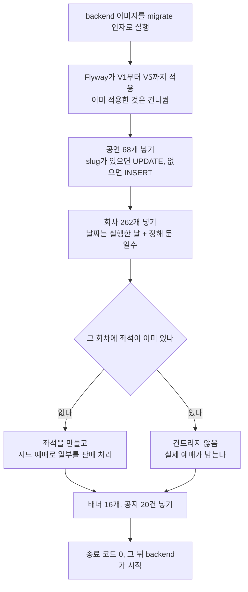

공연 번호는 목록 순서대로 1부터 68까지다. 포스터 파일 이름이 공연 번호라서 새 공연은 항상 목록 끝에 붙인다.

- 날짜는 고정이 아니다. migrate를 돌린 날이 기준이어서, 띄울 때마다 공연 날짜가 그날에 맞춰 다시 계산된다. 2026-11-25에 이 방식을 유지하기로 정했다.
- 시드 예매는 로그인할 수 없는 시드 계정의 것이다. 랭킹과 매진 표시가 비지 않게 하려고 넣는다.
- 배너는 16개가 들어가지만 API는 노출 기간 안의 것 가운데 앞에서 6개만 준다. 공연의 마지막 회차가 지나면 그 배너가 빠지고 뒤의 것이 올라온다.

## 13. 쿠버네티스에 올릴 때

`k8s/`에는 kustomize 구성이 있다. 공통 부분이 `base`이고 환경마다 다른 부분을 `overlays`가 덧붙인다.

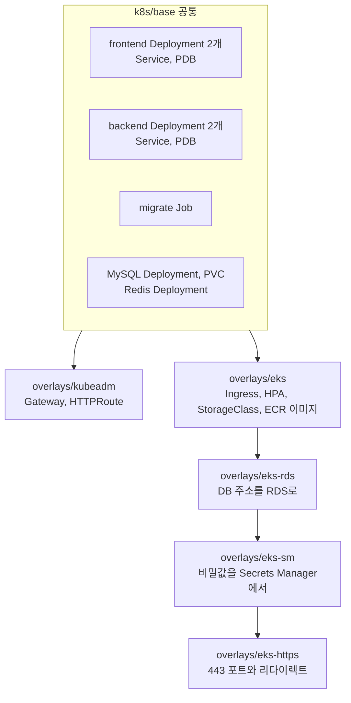

화살표는 '앞의 것 위에 덧붙인다'는 뜻이다. eks-https는 eks, eks-rds, eks-sm을 모두 포함한다.

이 구성은 과제를 제출할 때의 것이고 `next`의 변경을 아직 반영하지 않았다. 다시 올리기 전에 고칠 곳은 `docs/next/DEPLOY-CHANGES.md`에 모아 뒀다. 앱 계정에 세션 테이블 DELETE 권한 주기, 설명 주석 고치기, 새 환경변수 세 개가 전부다.

## 14. 만든 방식

화면과 서버를 서로 다른 작업 세션이 만들었다. 두 세션은 상대의 코드를 보지 않고 계약 문서만 본다.

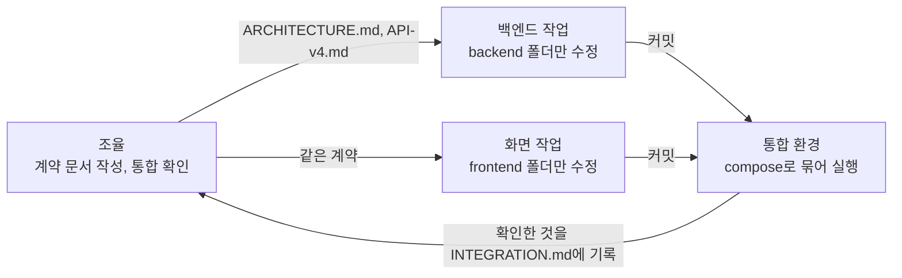

계약을 바꿔야 하면 문서를 먼저 고치고 양쪽에 알린다. 각자 확인했다고 한 것은 통합 환경에서 다시 실행해 본 것만 기록한다.

## 15. 고른 것과 이유

| 고른 것 | 고르지 않은 것 | 이유 |
|---|---|---|
| 로그인 세션을 MySQL에 | JWT, Redis 세션 | 서버에서 바로 무효화할 수 있다. 브라우저에 토큰을 저장하지 않는다. Redis가 비워져도 로그인이 유지된다 |
| 대기열과 선점을 Redis에 | DB 행 잠금 | 짧게 살고 한 번에 처리돼야 하며 잃어도 다시 만들 수 있는 상태다. TTL로 저절로 풀린다 |
| 확정은 DB 조건으로 최종 판단 | Redis의 선점만 믿기 | Redis가 틀려도 같은 좌석이 두 번 팔리지 않는다 |
| 요청이 올 때 Lua 스크립트로 상태를 전진 | 주기적으로 도는 정리 작업 | 서버가 여러 대여도 결과가 같고, 어느 서버가 작업을 맡을지 정할 필요가 없다 |
| 테이블 변경과 시드를 별도 실행으로 | 서버가 시작할 때 자동 적용 | 서버 여러 개가 동시에 스키마를 바꾸지 않는다. 권한이 큰 계정을 서버가 쓰지 않는다 |
| JdbcClient로 SQL을 직접 | JPA | 어떤 SQL이 나가는지 그대로 보인다. 좌석 집계나 조건부 UPDATE를 직접 쓴다 |
| 준비 상태는 MySQL만 기준 | Redis까지 포함 | Redis가 죽어도 둘러보기는 살아 있어야 한다 |
| Redis가 죽으면 예매를 닫는다 | 대기열 없이 통과 | 줄 선 순서가 무너지고 DB가 부하를 직접 받는다 |
| 화면 파일과 `/api`를 같은 주소로 | 주소를 나누고 CORS 허용 | 쿠키가 그대로 가고 CORS 설정이 필요 없다 |

## 16. 어디를 읽으면 되나

| 알고 싶은 것 | 파일 |
|---|---|
| 전체를 어떻게 띄우나 | `compose.yaml`, `docs/next/INTEGRATION.md` |
| API 약속 | `docs/ARCHITECTURE.md` 4장, `docs/next/API-v4.md` |
| 이미지 빌드 | `backend/Dockerfile`, `frontend/Dockerfile`, `frontend/nginx/nginx.conf` |
| 테이블 | `backend/src/main/resources/db/migration/V1`~`V5` |
| 대기열 | `queue/QueueService.java`, `resources/redis/queue-enter.lua`, `queue-poll.lua` |
| 좌석 선점 | `seat/SeatService.java`, `resources/redis/hold-create.lua` |
| 예매 확정 | `reservation/ReservationService.java`의 `confirm`, `createReservation` |
| 로그인과 세션 | `auth/AuthService.java`, `auth/SessionConfig.java` |
| 판매 상태 계산 | `show/SaleStatus.java`, `show/ShowService.java` |
| 시드 | `migrate/Seeder.java`, `docs/next/SHOWS-ADD.md`, `docs/next/BANNERS-ADD.md` |
| 화면 주소와 API 호출 | `frontend/src/App.tsx`, `frontend/src/api.ts`, `frontend/src/pages/` |
| 장애 상황 테스트 | `backend/src/test`의 `RedisLossIT`, `RedisDownIT`, `RedisPauseIT`, `SeatConcurrencyIT` |
| 전체 흐름 스크립트 | `test/scenario.sh` |
| 부하 시험 계획 | `docs/next/load-test.md` |
| 쿠버네티스 | `k8s/base`, `k8s/overlays`, `docs/next/DEPLOY-CHANGES.md` |

backend의 자바 파일은 모두 `backend/src/main/java/com/ticketing/` 아래에 있다.
