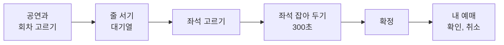
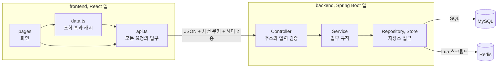

# 1. 한눈에 보기

이 프로그램이 무엇이고, 어떤 순서로 읽으면 되는지부터 본다.

미리내 마당은 공연 티켓을 예매하는 웹 서비스다. 공연을 고르고, 좌석을 고르고, 예매를 확정한다. 실제 결제는 하지 않는다.

예매 한 번은 아래 순서로 진행된다. 이 페이지의 대부분은 이 여섯 단계가 코드로 어떻게 되어 있는지에 대한 설명이다.

가운데 네 단계(줄 서기부터 확정까지)가 이 프로그램에서 가장 공들인 부분이다. 사람이 몰려도 같은 좌석이 두 번 팔리지 않아야 하기 때문이다.

## 프로그램은 둘이다

하나는 브라우저에서 도는 화면(`frontend`), 하나는 요청을 받아 처리하는 서버(`backend`)다. 화면은 서버에 정해진 주소로 묻고, 서버는 JSON으로 답한다. 서버는 데이터를 두 저장소에 둔다.

화면은 저장소에 직접 닿지 않는다. 항상 서버를 거친다.

## 먼저 알아 둘 낱말

| 용어 | 뜻 |
|---|---|
| 공연, 회차, 좌석 | 공연 하나에 날짜와 시간이 다른 회차가 여러 개 있다. 좌석은 회차마다 따로 있다. 같은 자리라도 회차가 다르면 다른 좌석이다. |
| 대기열 | 한꺼번에 몰릴 때 줄을 세우는 장치. 정해진 인원만 좌석 화면에 들여보낸다. |
| 임시 선점 | 확정하기 전까지 좌석을 잠깐 내 것으로 잡아 두는 것. 300초가 지나면 저절로 풀린다. |
| 확정 | 잡아 둔 좌석을 실제로 판매 처리하는 것. 이때 예매번호가 나온다. |
| MySQL | 표 모양으로 데이터를 저장하는 데이터베이스. 꺼졌다 켜져도 남는다. 회원, 공연, 좌석, 예매가 여기 있다. |
| Redis | 메모리에 데이터를 두는 빠른 저장소. 값마다 '몇 초 뒤 사라짐'을 걸 수 있다. 대기열과 임시 선점이 여기 있다. |
| API | 화면이 서버에 요청할 때 쓰는 정해진 주소와 형식. 예: `GET /api/shows`는 공연 목록을 달라는 뜻이다. |
| 세션 | 서버가 '이 브라우저는 누구로 로그인했다'를 적어 둔 기록. 브라우저는 그 기록의 번호만 쿠키로 갖고 있다. |
| 토큰 | 서버가 만들어 준, 추측할 수 없는 긴 무작위 문자열. 입장권처럼 요청에 붙여 보낸다. |
| 트랜잭션 | DB의 여러 변경을 하나로 묶는 것. 전부 되거나 전부 안 된다. |

## 읽는 순서

| 장 | 무엇을 알게 되나 |
|---|---|
| 2. 무엇을 하나 | 이 프로그램의 기능과 규칙 |
| 3. 예매가 되는 과정 | 줄 서기, 좌석 잡기, 확정이 어떻게 동작하나. 가장 중요한 장 |
| 4. 로그인 | 로그인 상태를 어떻게 기억하나 |
| 5. 데이터 | 어떤 데이터가 어디에 어떤 모양으로 있나 |
| 6. 백엔드 코드 | 서버 코드가 어떻게 나뉘어 있나 |
| 7. 프론트엔드 코드 | 화면 코드가 어떻게 나뉘어 있나 |
| 8. 아키텍처 패턴 | 프로그램 전체를 어떤 뼈대로 짰나 |
| 9. 디자인 패턴 | 클래스들을 어떤 패턴으로 짰나 |
| 10. 코드 읽는 순서 | 실제 파일을 어떤 순서로 열어 보면 되나 |

프로그램이 무엇을 하는지만 궁금하면 2장과 3장만 읽어도 된다. 코드를 직접 볼 생각이면 6장부터가 필요하다.

---

[차례](README.md) · [2. 무엇을 하나 →](02-features.md)
