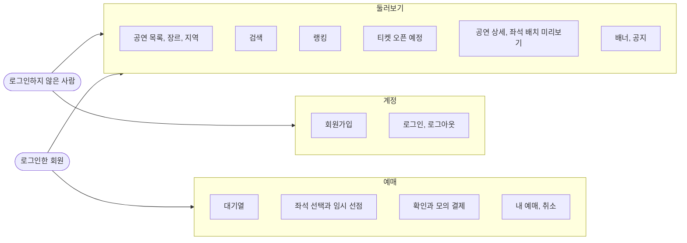

# 2. 무엇을 하나

기능 명세다. 누가 무엇을 할 수 있고, 어떤 규칙이 걸려 있는지 본다.

둘러보기는 누구나 할 수 있다. 예매와 내 예매는 로그인해야 한다.

예매의 네 기능은 위에서 아래 순서로 이어진다. 앞 단계를 지나야 다음 단계로 갈 수 있다.

## 둘러보기

| 기능 | 내용과 규칙 | API |
|---|---|---|
| 공연 목록 | 장르 4종(콘서트, 뮤지컬, 연극, 클래식), 지역, 판매 상태로 거른다. 정렬은 공연 가까운 순, 인기순, 낮은 가격순, 최근 등록순 | `GET /api/shows` |
| 검색 | 제목과 공연장에서 찾는다. 검색어는 1~40자. 최근 검색어 8개는 브라우저에만 둔다 | `GET /api/shows?q=` |
| 랭킹 | 일간(24시간), 주간(7일), 전체. 확정된 예매의 좌석 수로 순위를 매기고 점유율을 보여 준다. 최대 20개 | `GET /api/rankings` |
| 티켓 오픈 예정 | 예매 시작 전인 공연을 오픈 일시 순으로. 오픈 시각을 캘린더 파일로 받을 수 있다 | `GET /api/shows` |
| 공연 상세 | 달력에서 날짜, 회차, 등급별 남은 좌석을 본다. 좌석 배치는 미리 볼 수 있지만 판매 여부는 보이지 않는다 | `GET /api/shows/{id}`, `GET /api/performances/{id}/layout` |
| 배너, 공지 | 배너는 노출 기간 안의 것 최대 6개. 공지는 분류 2종, 고정 공지가 먼저, 쪽 나눔 | `GET /api/banners`, `GET /api/notices` |

## 계정

| 기능 | 내용과 규칙 | API |
|---|---|---|
| 회원가입 | 이메일, 비밀번호 8~72자, 이름 1~40자. 가입하면 바로 로그인된다 | `POST /api/auth/signup` |
| 로그인 | 연속 5번 틀리면 15분 잠긴다. 30분 동안 요청이 없으면 만료된다 | `POST /api/auth/login`, `POST /api/auth/logout` |

## 예매

| 기능 | 내용과 규칙 | API |
|---|---|---|
| 대기열 | 회차마다 동시에 100명(기본값)까지 입장한다. 입장 권한은 600초. 30초 동안 상태를 묻지 않으면 줄에서 빠진다 | `POST /api/queue/enter`, `GET /api/queue/status`, `DELETE /api/queue` |
| 좌석 선택 | 등급별 색으로 좌석을 보여 주고 판매된 좌석과 남이 잡은 좌석을 표시한다. 한 번에 4석까지 | `GET /api/performances/{id}/seats` |
| 임시 선점 | 고른 좌석을 300초 동안 잡는다. 전부 잡거나 하나도 잡지 않는다. 한 사람은 선점 하나 | `POST /api/performances/{id}/holds`, `DELETE /api/holds/{holdId}` |
| 예매 확정 | 결제는 하지 않고 수단 이름만 기록한다(CARD, EASY_PAY, BANK_TRANSFER). 한 계정은 한 회차에 4석까지. 예매번호 12자를 발급한다 | `POST /api/reservations` |
| 내 예매 | 최근 순 목록(취소한 것 포함). 회차가 시작하기 전까지 취소할 수 있다 | `GET /api/me/reservations`, `POST /api/me/reservations/{code}/cancel` |

## 숫자로 정해 둔 규칙

| 규칙 | 값 | 이유 |
|---|---|---|
| 한 번에 고를 수 있는 좌석 | 4석 | 한 사람이 좌석을 쓸어 가지 못하게 |
| 한 계정이 한 회차에서 가질 수 있는 좌석 | 4석 | 여러 번 나눠 예매해도 합쳐서 센다 |
| 좌석을 잡아 두는 시간 | 300초 | 잡고 떠난 사람의 좌석이 다시 풀리게 |
| 좌석 화면에 동시에 들어가는 인원 | 회차당 100명(기본값) | 서버와 DB가 감당할 만큼만 들여보낸다 |
| 입장한 뒤 머물 수 있는 시간 | 600초 | 자리를 차지하고 아무것도 안 하는 사람을 내보낸다 |
| 줄에서 빠지는 조건 | 30초 동안 화면이 상태를 묻지 않음 | 창을 닫은 사람이 줄에 남지 않게 |
| 로그인 실패 잠금 | 연속 5번이면 15분 | 비밀번호를 마구 넣어 보지 못하게 |
| 로그인 유지 | 요청이 없으면 30분 뒤 만료 |  |

## 기능은 아니지만 지켜야 하는 것

- 같은 좌석이 두 번 팔리지 않는다. 두 사람이 동시에 눌러도 마찬가지다.
- 서버를 여러 대로 늘려도 결과가 같다.
- Redis의 내용이 사라져도 회원, 예매 내역, 로그인은 남는다.
- 비밀번호는 원문을 저장하지 않는다. 이메일은 응답에서 일부를 가린다.

넣지 않은 것: 실제 결제, 쿠폰과 할인, 배송, 관리자 화면, 리뷰, 소셜 로그인, 비밀번호 찾기, 비회원 예매.

---

[← 1. 한눈에 보기](01-start.md) · [차례](README.md) · [3. 예매가 되는 과정 →](03-booking.md)
