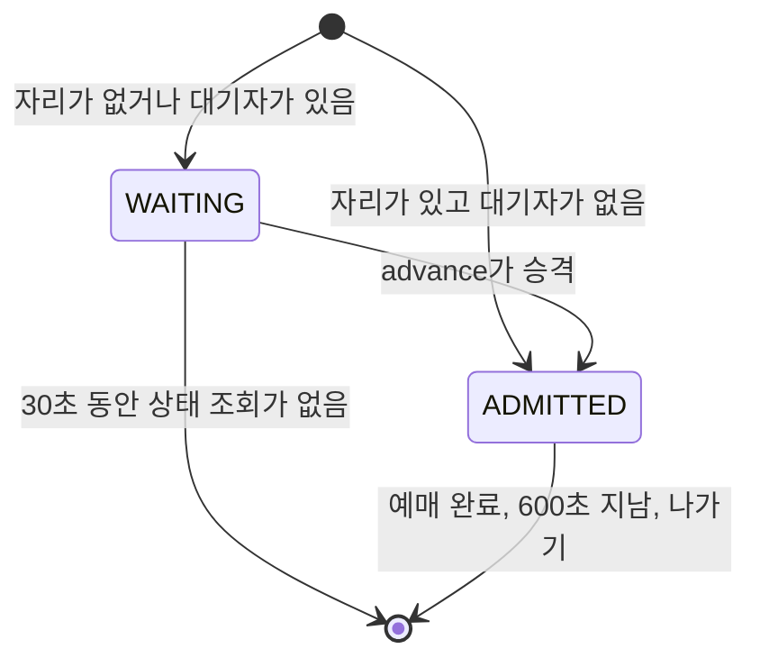
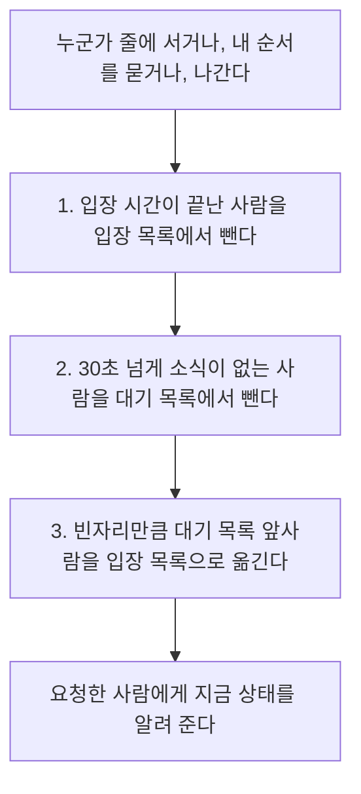
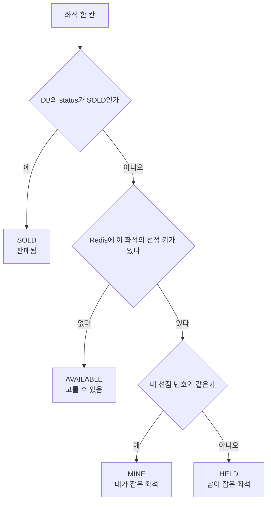
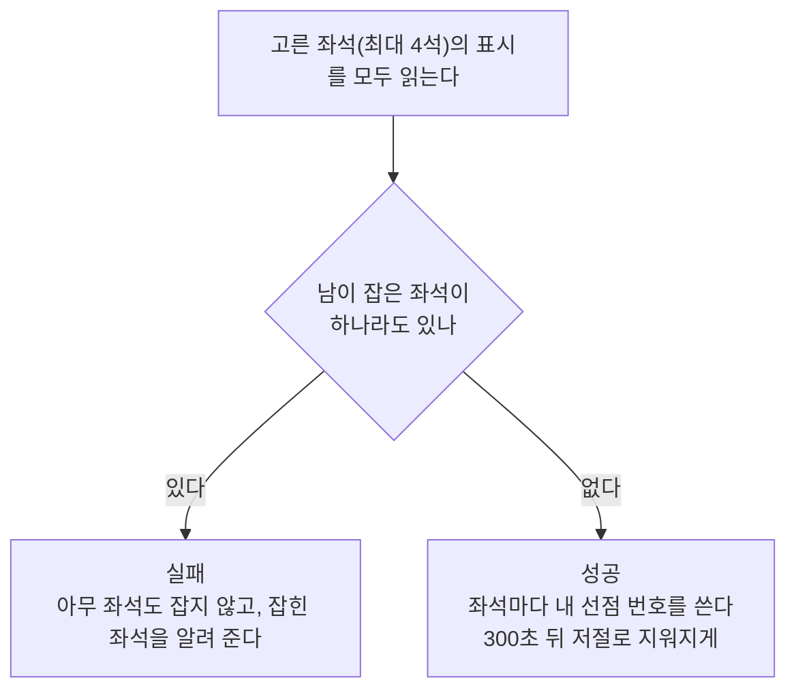
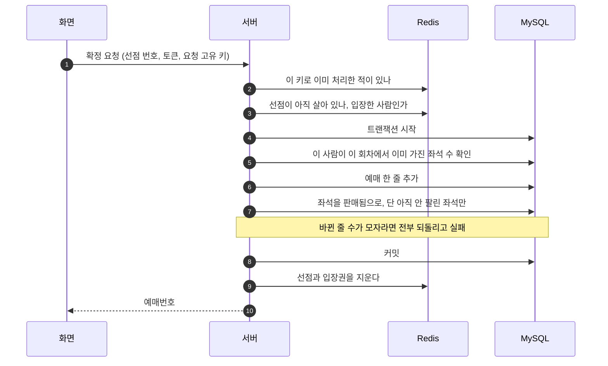
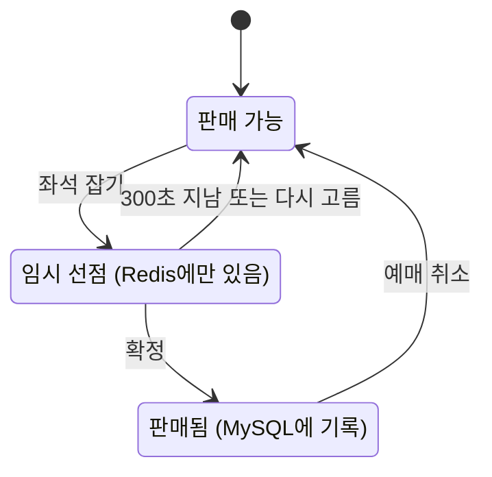

# 3. 예매가 되는 과정

예매하기를 누른 뒤 일어나는 일을 네 단계로 따라간다. 단계마다 풀어야 할 문제가 하나씩 있다.

## 1단계. 줄 서기

**문제.** 티켓이 열리는 순간 많은 사람이 한꺼번에 좌석 화면으로 들어온다. 전부 받으면 서버와 DB가 버티지 못한다.

**해결.** 회차마다 100명만 좌석 화면에 들여보내고 나머지는 줄을 세운다. 누군가 나가면 줄 맨 앞사람이 들어간다. 서버는 들어온 사람에게 토큰(입장권)을 주고, 이후 요청마다 그 토큰을 확인한다.

토큰의 상태는 둘뿐이다. 기다리는 중(WAITING)이거나 입장했거나(ADMITTED).

줄은 Redis에 있다. 기다리는 사람 목록과 입장한 사람 목록, 두 개다. 줄을 앞으로 당기는 일은 누군가 요청을 보낼 때마다 아래 순서로 한다. 따로 돌아가는 관리 프로그램이 없다.

이 네 줄이 Redis 안에서 한 번에 실행된다. 중간에 다른 요청이 끼어들지 못해서 순서가 꼬이지 않는다.

- 기다리는 화면은 몇 초마다 '내 순서가 됐나요'를 묻는다. 간격은 서버가 정해 준다(앞에 사람이 적으면 2초, 많으면 5초).
- 빈자리가 있어도 기다리는 사람이 있으면 새로 온 사람은 줄 맨 뒤에 선다. 새치기가 없다.
- 주소를 직접 쳐서 좌석 화면으로 가도 소용없다. 좌석 조회, 잡기, 확정 모두 서버가 토큰을 다시 확인한다.

## 2단계. 좌석 보기

**문제.** 좌석의 상태는 두 곳에 나뉘어 있다. 팔렸는지는 MySQL에, 누가 잠깐 잡고 있는지는 Redis에 있다.

**해결.** 서버가 둘을 합쳐 좌석마다 네 가지 상태 중 하나로 알려 준다.

화면은 몇 초마다 좌석을 다시 받아서 남이 잡은 좌석을 바로 표시한다.

## 3단계. 좌석 잡아 두기

**문제.** 두 사람이 같은 좌석을 거의 동시에 누른다. '비었나 확인'과 '내 것으로 표시' 사이에 다른 사람이 끼어들면 둘 다 잡았다고 믿게 된다.

**해결.** 확인과 표시를 Redis 스크립트 하나로 묶는다. Redis는 스크립트를 실행하는 동안 다른 요청을 받지 않으므로 끼어들 틈이 없다.

전부 잡거나 하나도 잡지 않는다. 네 좌석 중 세 좌석만 잡히는 일은 없다.

- 좌석마다 Redis에 표시가 하나씩 생긴다. 표시에는 만료 시간이 붙어 있어서 300초가 지나면 저절로 사라진다. 풀어 주는 작업을 따로 돌리지 않는다.
- 한 사람은 선점을 하나만 가진다. 좌석을 바꿔 다시 고르면 이전 선점은 같은 스크립트 안에서 풀린다.
- 이 단계까지는 MySQL에 아무것도 쓰지 않는다.

## 4단계. 확정

**문제.** Redis는 빠르지만 내용이 사라질 수 있다. Redis만 믿고 팔면, Redis가 비워진 순간 같은 좌석을 두 사람에게 팔 수 있다.

**해결.** 마지막 판단은 MySQL이 한다. 좌석을 '판매됨'으로 바꾸는 SQL에 '아직 안 팔린 좌석만'이라는 조건을 건다. 바뀐 줄 수가 고른 좌석 수보다 적으면 누가 먼저 산 것이므로 전부 되돌린다.

MySQL에 쓰는 것은 이 한 번뿐이다. 앞 단계의 Redis는 사람을 걸러 주는 역할이고, 최종 판단은 여기서 한다.

확정에는 안전장치가 세 겹 있다.

| 막으려는 일 | 장치 |
|---|---|
| 같은 좌석이 두 번 팔림 | SQL의 조건 `WHERE status = 'AVAILABLE'`과 바뀐 줄 수 확인 |
| 한 사람이 동시에 두 번 확정해 4석을 넘김 | 그 사람의 회원 줄을 잠근 뒤 좌석 수를 센다. 두 요청이 한 줄로 서게 된다 |
| 응답을 못 받아 확정을 다시 보냄 | 요청 고유 키(`Idempotency-Key`). 같은 키의 두 번째 요청에는 처음 응답을 그대로 준다 |

## 좌석 하나의 일생

취소는 회차가 시작하기 전까지 할 수 있다. 취소하면 좌석이 다시 판매 가능으로 돌아간다.

> **빠르게 걸러 내는 일은 Redis가, 틀리면 안 되는 마지막 판단은 MySQL이 한다.**

---

[← 2. 무엇을 하나](02-features.md) · [차례](README.md) · [4. 로그인 →](04-login.md)
