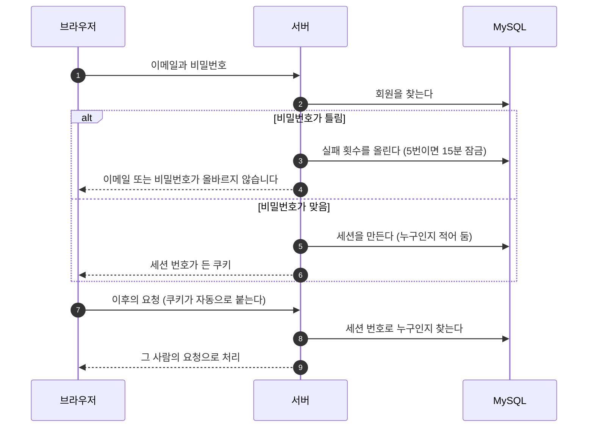

# 4. 로그인

서버가 '이 요청은 누가 보낸 것인가'를 어떻게 아는지 본다.

웹 요청은 서로 이어져 있지 않다. 서버는 방금 로그인한 사람과 지금 요청한 사람이 같은지 저절로 알지 못한다. 그래서 로그인하면 서버가 기록(세션)을 만들고, 그 기록의 번호를 브라우저에 쿠키로 준다. 브라우저는 이후 요청마다 그 쿠키를 자동으로 붙인다.

브라우저가 가진 것은 번호뿐이다. 누구인지는 서버 쪽 MySQL에 적혀 있다.

## 왜 이렇게 했나

- 세션을 서버 메모리가 아니라 MySQL에 둔다. 서버가 여러 대여도 어느 서버로 요청이 가든 로그인이 유지되고, 서버를 다시 켜도 로그아웃되지 않는다.
- 로그아웃하면 서버에서 세션을 지운다. 그 순간부터 그 번호는 쓸모없다. 브라우저에 로그인 정보를 저장해 두는 방식(JWT)은 이렇게 바로 끊기가 어렵다.
- 쿠키는 자바스크립트가 읽지 못하게 설정했다(HttpOnly). 화면에 나쁜 스크립트가 끼어들어도 세션 번호를 훔치지 못한다.
- 로그인에 성공하면 세션 번호를 새로 만든다. 로그인 전의 번호를 누가 알고 있어도 쓸 수 없다.

## 비밀번호

- 비밀번호는 원문을 저장하지 않는다. BCrypt라는 방식으로 바꾼 값(해시)만 저장한다. 해시에서 원문을 되돌릴 수 없다.
- '없는 이메일'과 '틀린 비밀번호'에 같은 문구로 답한다. 가입된 이메일인지 알아낼 수 없게 하려는 것이다.
- 이메일이 없을 때도 가짜 해시와 한 번 비교한다. 응답이 걸리는 시간으로도 구분할 수 없게 하려는 것이다.

## 다른 사이트가 보낸 가짜 요청 막기

쿠키는 브라우저가 자동으로 붙인다. 그래서 다른 사이트가 사용자 몰래 우리 서버로 요청을 보내도 쿠키가 따라간다. 이것을 막으려고 서버는 세션마다 무작위 값(CSRF 토큰)을 하나 더 만들어 화면에 알려 준다. 화면은 무언가를 바꾸는 요청마다 이 값을 `X-CSRF-Token` 헤더에 넣어 보낸다. 다른 사이트는 이 값을 알 수 없으므로 서버가 거절한다.

코드에서는 `auth` 패키지가 맡는다. 비밀번호 확인은 `AuthService`, 세션에 넣고 꺼내기는 `SessionAuth`, 헤더 검사는 `CsrfFilter`다.

---

[← 3. 예매가 되는 과정](03-booking.md) · [차례](README.md) · [5. 데이터 →](05-data.md)
