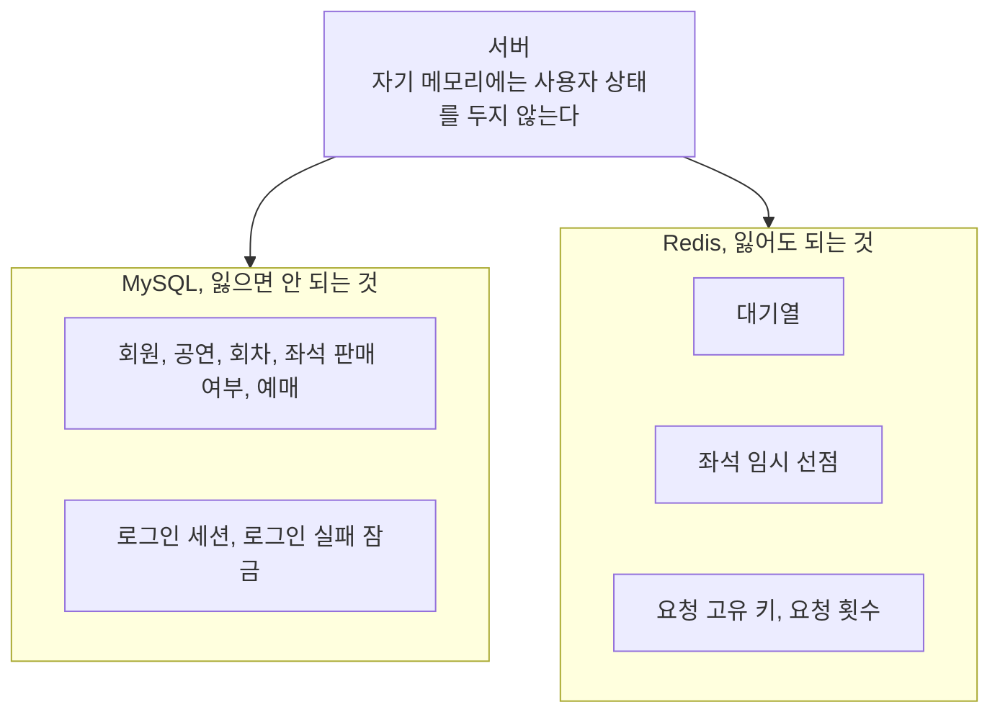
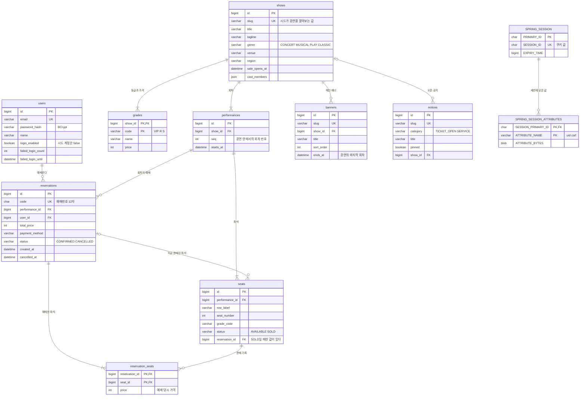
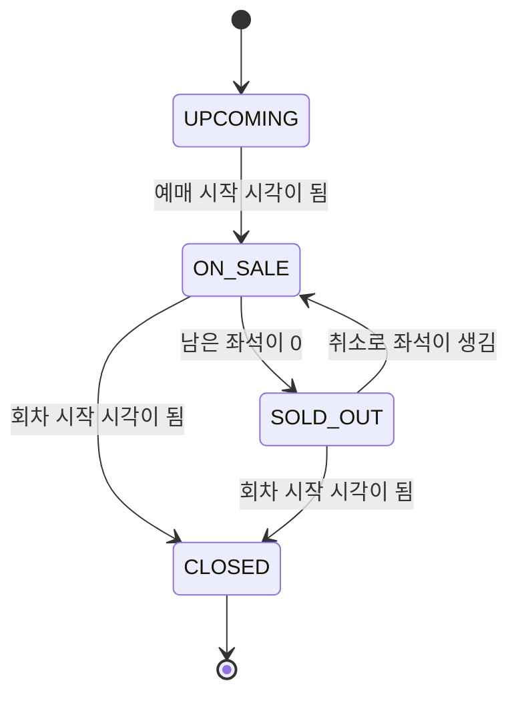
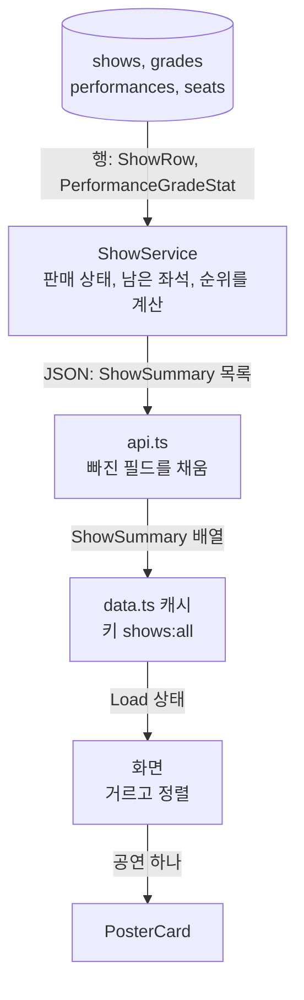

# 5. 데이터

어떤 데이터가 어느 저장소에 어떤 모양으로 있고, 화면까지 어떻게 오는지 본다.

## 두 저장소에 나눠 둔다

기준은 하나다. 잃으면 안 되는 것은 MySQL에, 잃어도 다시 만들 수 있는 것은 Redis에 둔다.

Redis의 내용이 전부 사라지면 기다리던 사람은 다시 줄을 서고, 좌석을 잡았던 사람은 다시 고르면 된다. 팔린 좌석과 예매 내역은 그대로다.

## MySQL의 표

중심은 공연, 회차, 좌석 세 표다. 선은 '하나에 여러 개가 딸린다'는 뜻이다. 예를 들어 공연 하나에 회차가 여러 개 딸린다.

주요 열만 적었다. PK는 그 줄을 가리키는 고유 번호, FK는 다른 표의 줄을 가리키는 번호다.

- `seats`(좌석)는 회차마다 따로 만든다. 좌석 한 줄에 상태(`AVAILABLE` 또는 `SOLD`)와, 팔렸다면 어느 예매에 팔렸는지가 적혀 있다.
- `reservation_seats`는 예매 당시의 기록이다. 취소해서 좌석이 다시 풀려도 누가 어떤 좌석을 얼마에 샀는지는 남는다.
- 임시 선점과 대기열은 이 그림에 없다. Redis에 있다.

## DB가 스스로 막는 것

코드가 실수해도 DB가 받아 주지 않도록 제약을 걸어 두었다.

| 제약 | 막는 일 |
|---|---|
| 좌석의 `(회차, 행, 번호)`는 겹칠 수 없다 | 같은 회차에 같은 자리가 두 번 생기는 것 |
| 좌석이 `SOLD`면 예매 번호가 있어야 하고, 아니면 없어야 한다 | 팔렸는데 주인이 없거나, 안 팔렸는데 주인이 있는 것 |
| 회원의 이메일은 겹칠 수 없다 | 같은 이메일로 동시에 두 번 가입하는 것 |
| 예매번호는 겹칠 수 없다 | 우연히 같은 번호가 두 번 나오는 것 |

## 저장하지 않고 계산하는 값

'판매 중', '매진', '판매 종료' 같은 판매 상태는 표에 없다. 요청을 받을 때마다 지금 시각과 남은 좌석 수로 계산한다. 그래서 시간이 지나면 저절로 바뀌고, 상태를 고쳐 주는 작업이 필요 없다.

회차의 상태다. 공연의 상태는 회차들을 보고 정한다. 모든 회차가 CLOSED면 공연도 판매 종료다.

## DB에서 화면까지

공연 목록 한 번이 화면에 나오기까지 자료의 모양이 여러 번 바뀐다.

표에 없는 값(판매 상태, 남은 좌석, 순위)은 서버가 계산해서 붙인다. 화면은 한 번 받은 목록을 30초 동안 다시 쓴다.

## 값마다 어디에 있나

| 값 | 만드는 곳 | 두는 곳 | 주고받는 방법 | 사라지는 때 |
|---|---|---|---|---|
| 세션 번호 | 서버(Spring Session) | MySQL `SPRING_SESSION`, 브라우저 쿠키 | 쿠키(HttpOnly). 자바스크립트는 읽지 못한다 | 30분 동안 요청 없음, 로그아웃 |
| CSRF 토큰 | `SessionAuth`, 256비트 난수 | 세션 속성, `api.ts`의 변수 | `X-CSRF-Token` 헤더 | 로그인할 때 새로 발급 |
| 대기열 토큰 | `QueueTokens`, 256비트 난수 | Redis에는 SHA-256만, 브라우저 `sessionStorage`에 원문 | `X-Queue-Token` 헤더 | 예매 완료, 입장 만료, 나가기, 탭 닫기 |
| 선점 번호 | `QueueTokens`, 128비트 난수 | Redis, 브라우저 `sessionStorage` | 요청 본문 | 300초, 확정, 좌석 다시 고르기 |
| Idempotency-Key | 브라우저(uuid) | Redis, 확인 화면의 메모리 | 헤더 | 완료 뒤 24시간 |
| 예매번호 | `ReservationCodeGenerator` | MySQL `reservations.code` | 응답, 취소 요청의 주소 | 남는다 |
| 이메일 | 사용자 입력 | `users`에 원문. `reservations`에는 해시와 가린 값만 | 요청 본문. 응답에는 가린 값 | 남는다 |
| 비밀번호 | 사용자 입력 | `users`에 BCrypt 해시만 | 요청 본문 | 원문은 저장하지 않는다 |

공연 68개, 회차 262개, 좌석 39,308석 같은 처음 데이터는 `migrate` 패키지의 `Seeder`가 넣는다. 여러 번 실행해도 결과가 같게 만들었다. 이미 좌석이 있는 회차는 건드리지 않는다.

---

[← 4. 로그인](04-login.md) · [차례](README.md) · [6. 백엔드 코드 →](06-backend.md)
