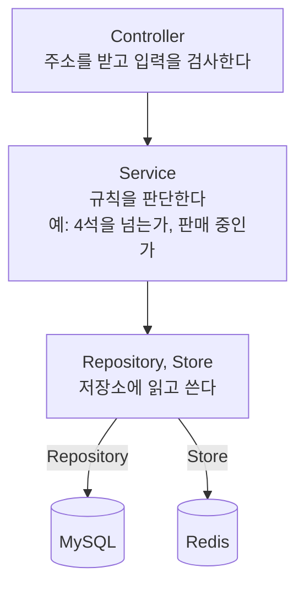
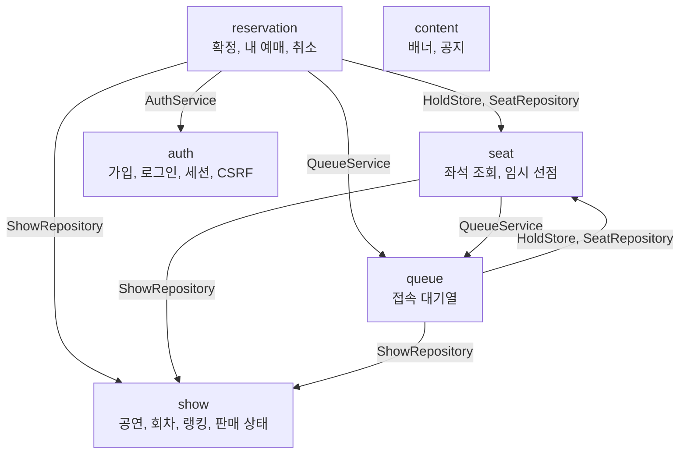
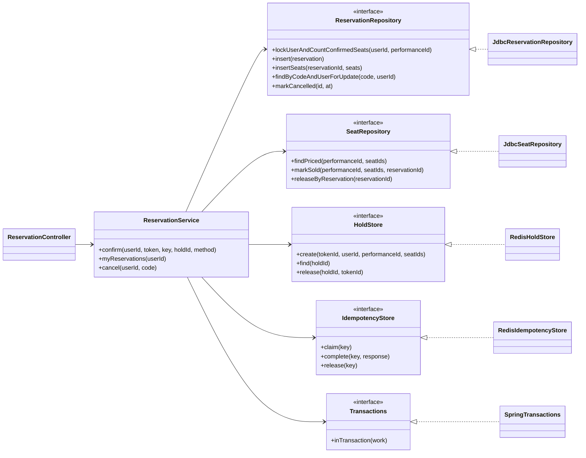
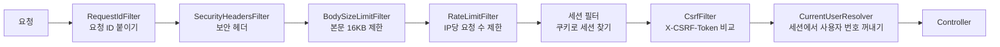
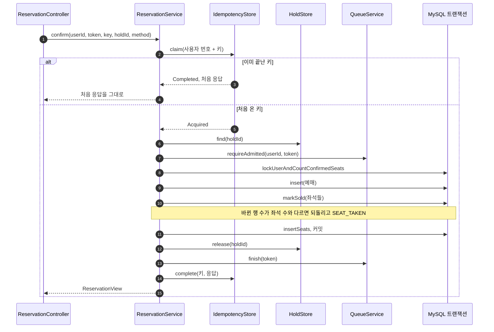

# 6. 백엔드 코드

서버 코드가 어떤 덩어리로 나뉘어 있고, 요청 하나가 그 사이를 어떻게 지나는지 본다. Java 21과 Spring Boot 3으로 썼다.

## 세 층

코드는 하는 일에 따라 세 층으로 나뉜다. 요청은 위에서 아래로만 내려간다.

이름으로 구분한다. MySQL을 다루면 Repository, Redis를 다루면 Store다.

- 층을 나누는 이유: 규칙을 고칠 때 SQL이나 주소를 건드리지 않아도 된다. 반대로 SQL을 고쳐도 규칙은 그대로다.
- DB는 `JdbcClient`로 SQL을 직접 쓴다. 자동으로 SQL을 만들어 주는 도구(JPA)를 쓰지 않아서 어떤 SQL이 나가는지 코드에 그대로 보인다.

## 기능별 폴더

폴더(패키지)는 층이 아니라 기능으로 나눴다. 예매를 고치려면 `reservation` 폴더만 열면 그 안에 Controller, Service, Repository가 다 있다. 화살표는 '이쪽이 저쪽의 클래스를 쓴다'는 뜻이다.

reservation이 맨 위에 있다. 확정 한 번에 선점, 대기열, 회원, 공연을 모두 확인하기 때문이다.

| 패키지 | 들어 있는 것 |
|---|---|
| `show` | `ShowController`, `RankingController`, `ShowService`, `ShowRepository`, `SaleStatus` |
| `queue` | `QueueController`, `QueueService`, `QueueStore`, `QueueTokens`, `RedisKeys`, `LuaScripts` |
| `seat` | `SeatController`, `SeatService`, `SeatRepository`, `HoldStore` |
| `reservation` | `ReservationController`, `ReservationService`, `ReservationRepository`, `IdempotencyStore`, `ReservationCodeGenerator` |
| `auth` | `AuthController`, `AuthService`, `SessionAuth`, `CsrfFilter`, `CurrentUserResolver`, `UserRepository`, `LoginAttemptStore` |
| `content` | `ContentController`, `ContentService`, `ContentRepository` |
| `web`, `ratelimit` | 공통 필터 4개, `RateLimiter` |
| `common`, `config` | `ErrorCode`, `ApiException`, `GlobalExceptionHandler`, `Transactions`, `AppProperties` |
| `migrate` | `Seeder`, `AddedShows`, `ContentSeed`. 시드 데이터를 넣는 별도 실행 모드 |

## 서비스는 인터페이스만 안다

인터페이스는 '이런 일을 할 수 있다'는 약속만 적은 것이고, 실제로 하는 코드는 구현 클래스에 있다. 서비스는 약속만 보고 일한다. 그림은 예매 기능이다.

네모 위쪽에 interface라고 적힌 것이 약속, 점선 화살표 끝의 클래스가 실제 구현이다.

- 이렇게 하면 테스트할 때 진짜 DB 대신 가짜 구현을 끼워 넣을 수 있다. 규칙만 빠르게 시험한다.
- 서비스가 쓸 것들은 모두 생성자로 받는다(의존성 주입). 서비스가 직접 만들지 않는다.

## 요청이 컨트롤러에 닿기 전

모든 요청은 컨트롤러에 가기 전에 검문소(필터) 여섯 개를 차례로 지난다. 어느 기능이든 공통으로 해야 하는 검사를 여기에 모았다.

요청 수 제한이 세션 조회보다 앞에 있다. 몰려드는 요청은 DB에 닿기 전에 걸러진다.

## 오류가 응답이 되는 길

서비스는 규칙에 어긋나면 `ApiException`을 던지기만 한다. 응답으로 바꾸는 일은 `GlobalExceptionHandler` 한 곳에서 한다. 오류의 종류는 `ErrorCode`에 모두 모여 있고, 종류마다 HTTP 상태와 사용자에게 보여 줄 문장이 붙어 있다.

| 오류 코드 | 상태 | 뜻 |
|---|---|---|
| `SEAT_TAKEN` | 409 | 고른 좌석 중 이미 잡혔거나 팔린 좌석이 있다 |
| `HOLD_EXPIRED` | 409 | 좌석을 잡아 둔 시간이 지났다. 다시 골라야 한다 |
| `QUEUE_TOKEN_INVALID` | 401 | 입장권이 없거나 만료됐다. 다시 줄을 서야 한다 |
| `QUEUE_NOT_ADMITTED` | 403 | 아직 순서가 아니다 |
| `BOOKING_LIMIT_EXCEEDED` | 409 | 이 회차에서 4석을 넘는다 |
| `UNAUTHENTICATED` | 401 | 로그인이 필요하다 |
| `RATE_LIMITED` | 429 | 요청이 너무 많다 |
| `SERVICE_UNAVAILABLE` | 503 | Redis에 닿지 못해 예매를 잠시 진행할 수 없다 |

## 예: 확정 한 번에 클래스들이 주고받는 것

3장의 확정 단계를 클래스 이름으로 다시 그린 것이다. `ReservationService.confirm`이 전체를 지휘한다.

가운데의 alt 상자는 갈림길이다. 이미 처리한 요청이면 위쪽, 처음 온 요청이면 아래쪽으로 간다.

---

[← 5. 데이터](05-data.md) · [차례](README.md) · [7. 프론트엔드 코드 →](07-frontend.md)
