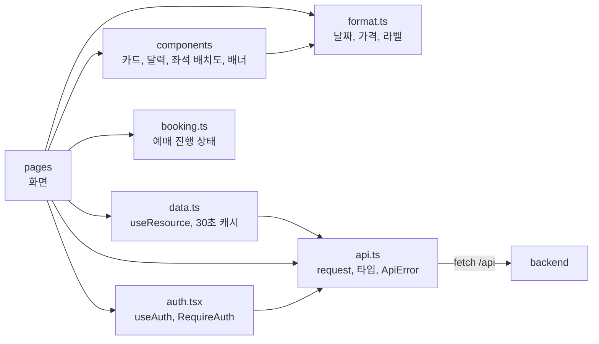
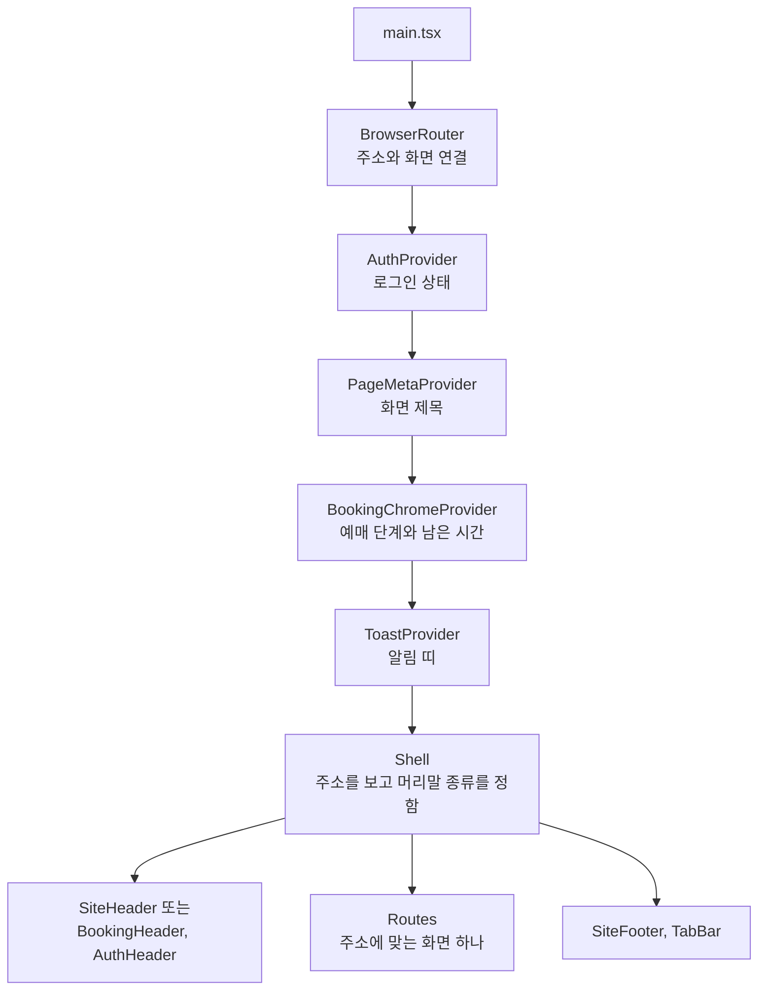
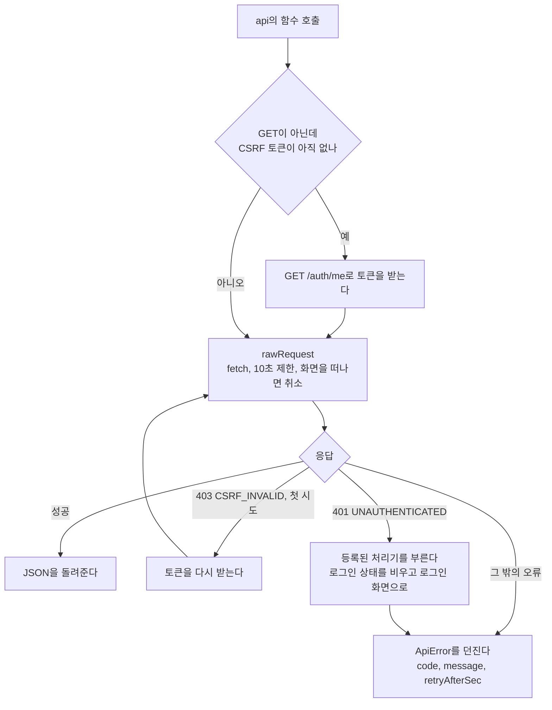
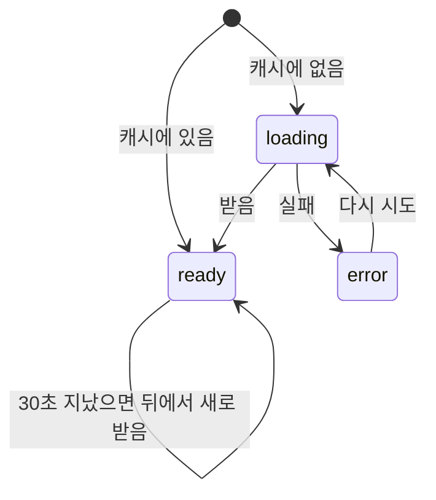
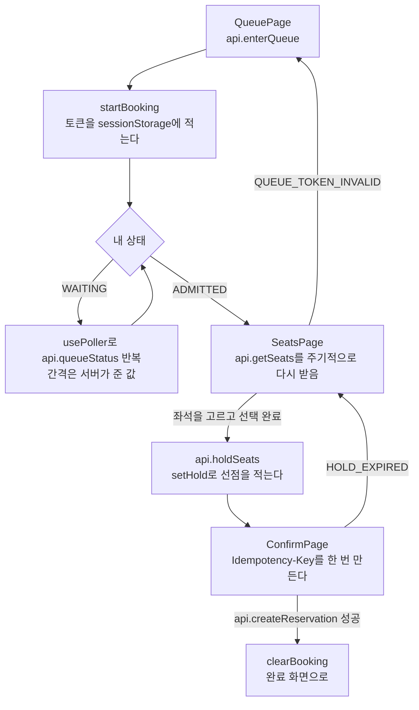

# 7. 프론트엔드 코드

화면 코드가 어떻게 나뉘어 있고, 서버에서 받은 데이터를 어떻게 다루는지 본다. TypeScript와 React로 썼다.

## 파일이 맡은 일

서버와 말하는 곳은 api.ts 하나다. 화면은 fetch를 직접 부르지 않는다.

| 파일 | 맡은 일 |
|---|---|
| `pages/` | 화면 하나가 파일 하나. 메인, 공연 상세, 대기, 좌석 선택, 확인, 내 예매 등 |
| `components/` | 여러 화면이 같이 쓰는 조각. 포스터 카드, 달력, 좌석 배치도, 배너 |
| `api.ts` | 서버 호출 전부. 응답의 모양(타입)도 여기 적혀 있다 |
| `data.ts` | 목록을 받아 오고 잠깐 기억해 두는 훅 |
| `auth.tsx` | 로그인 상태를 모든 화면에 알려 준다 |
| `booking.ts` | 예매 진행 상태(입장권, 선점)를 적어 둔다 |
| `App.tsx`, `shell.tsx` | 주소와 화면을 잇고, 머리말과 바닥글을 그린다 |

## 화면이 그려지는 순서

앱은 `main.tsx`에서 시작한다. 로그인 상태나 알림처럼 여러 화면이 함께 쓰는 값을 바깥에서 감싸 준 뒤(공급자), 주소에 맞는 화면 하나를 그린다.

예매 화면과 로그인 화면은 머리말이 다르다. Shell이 주소를 보고 정한다.

## 서버를 한 번 부를 때

화면은 `api.holdSeats(...)`처럼 함수만 부른다. 그 안에서 보안 값 붙이기, 만료된 값 다시 받기, 로그인 만료 알리기를 `request()` 하나가 처리한다.

저절로 다시 시도하는 것은 CSRF 토큰이 만료됐을 때 한 번뿐이다. 나머지 오류는 화면이 받아 문구와 단추를 정한다.

## 받아 온 데이터의 세 상태

서버에서 무언가를 받아 오는 화면은 항상 셋 중 하나의 상태다. 받는 중(`loading`), 받음(`ready`), 실패(`error`). 화면은 이 값에 따라 뼈대, 내용, 오류 안내 중 하나를 그린다. 이 일을 `useResource` 훅 하나가 한다.

한 번 받은 목록은 30초 동안 기억한다. 다른 화면으로 갔다 와도 바로 보이고, 오래됐으면 뒤에서 새로 받아 바꾼다.

## 값을 어디에 두나

| 상태 | 두는 곳 | 이유 |
|---|---|---|
| 로그인한 사용자 | `AuthProvider`의 state | 어느 화면에서나 `useAuth()`로 읽는다 |
| CSRF 토큰 | `api.ts`의 모듈 변수 | 어떤 저장소에도 넣지 않는다. 새로 고치면 `/auth/me`로 다시 받는다 |
| 조회한 목록(공연, 랭킹, 배너) | `data.ts`의 `Map` | 여러 화면이 같은 목록을 쓴다. 탭의 메모리에만 있다 |
| 대기열 토큰, 선점 | `sessionStorage` | 새로 고쳐도 이어 가야 하고 탭을 닫으면 사라져야 한다 |
| 필터, 정렬, 펼친 개수 | 방문 기록의 state | 상세에 갔다가 뒤로 오면 그대로다 |

상태 관리 라이브러리는 쓰지 않았다. 여러 화면이 함께 쓰는 값이 로그인, 받아 온 목록, 예매 진행 상태 셋뿐이라 React의 기본 기능으로 충분하다.

## 예매 화면 세 개

대기, 좌석 선택, 확인 화면은 `booking.ts`에 적어 둔 입장권과 선점을 함께 본다. 서버가 '입장권이 없다'거나 '선점이 없다'고 답하면 한 단계 앞 화면으로 돌아간다.

입장권과 선점은 브라우저의 sessionStorage에 둔다. 새로 고쳐도 이어지고 탭을 닫으면 사라진다.

---

[← 6. 백엔드 코드](06-backend.md) · [차례](README.md) · [8. 아키텍처 패턴 →](08-arch-patterns.md)
