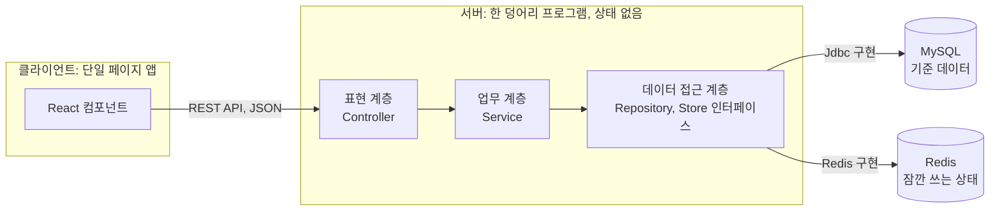

# 8. 아키텍처 패턴

아키텍처 패턴은 프로그램 전체를 어떤 덩어리로 나누고 어떻게 잇는가에 대한 것이다. 이 프로그램이 고른 것과 고르지 않은 것을 본다.

한 문장으로 줄이면 이렇다. **화면은 단일 페이지 앱, 서버는 계층형으로 짠 한 덩어리 프로그램이고, 둘은 REST API로만 만난다.**

이 그림 하나에 아래 표의 1번부터 7번이 다 들어 있다.

## 쓴 것

|  | 패턴 | 이 프로그램에서 | 왜 |
|---|---|---|---|
| 1 | 클라이언트-서버, 단일 페이지 앱(SPA) + REST API | 서버는 HTML을 만들지 않고 JSON만 준다. 화면은 React가 브라우저에서 그리고, 주소가 바뀌어도 페이지를 새로 받지 않는다 | 화면과 서버를 따로 만들고 따로 고칠 수 있다. 약속은 API 문서 하나다 |
| 2 | 계층형 아키텍처(3계층) | Controller(표현) → Service(업무) → Repository, Store(데이터 접근). 위에서 아래로만 부른다 | 주소 처리, 규칙, 저장을 섞지 않는다. 한 층을 고쳐도 다른 층이 그대로다 |
| 3 | 모놀리식(한 덩어리 서버) | 서버는 실행 파일 하나다. 예매, 대기열, 회원이 같은 프로그램 안에 있다 | 확정 한 번에 좌석, 예매, 회원을 한 트랜잭션으로 묶어야 한다. 나누면 이것이 어려워진다. 규모도 작다 |
| 4 | 기능별 패키지(모듈형 모놀리식) | `show`, `queue`, `seat`, `reservation`, `auth`, `content`. 기능마다 폴더 하나에 세 층이 다 있다 | 한 기능을 고칠 때 한 폴더만 본다 |
| 5 | 포트와 어댑터(헥사고날)의 일부 | 서비스는 `QueueStore`, `SeatRepository` 같은 인터페이스(포트)만 알고, `Redis...`, `Jdbc...` 클래스(어댑터)가 실제 저장소에 닿는다 | 테스트에서 저장소를 가짜로 바꿔 끼운다. 저장 기술을 바꿔도 규칙 코드는 그대로다 |
| 6 | 상태 없는 서버 | 서버 메모리에 사용자 상태를 두지 않는다. 로그인 세션은 MySQL에, 대기열과 선점은 Redis에 있다 | 서버를 여러 대로 늘려도 어느 서버가 받든 결과가 같다 |
| 7 | 저장소 두 종류를 역할로 나누기 | MySQL은 기준 데이터(회원, 좌석, 예매), Redis는 잠깐 쓰는 상태(대기열, 선점) | 빠르고 만료가 필요한 것과, 느려도 틀리면 안 되는 것의 성격이 다르다 |
| 8 | 서비스 계층 + 트랜잭션 스크립트 | 규칙이 서비스 메서드 안에 '확인하고, 쓰고, 정리한다' 순서로 적혀 있다. 데이터는 값만 담는 `record`다 | 예매 규칙은 순서가 전부이고 SQL, Redis 호출과 맞물려 있다. 객체가 규칙을 갖는 방식보다 읽기 쉽다 |
| 9 | 계약 우선 API | API 문서(`ARCHITECTURE.md` 4장, `API-v4.md`)를 먼저 쓰고 화면과 서버가 각자 그 문서대로 만들었다 | 서로의 코드를 보지 않고 동시에 만들 수 있다 |
| 10 | 가상 대기실(입장 제어) | `queue` 패키지가 좌석 화면에 들어가는 인원을 회차당 100명으로 묶는다 | 몰리는 순간에도 뒤쪽(좌석 조회, DB)이 받는 양이 일정하다 |
| 11 | 컴포넌트 기반 화면, 단방향 데이터 흐름 | 화면은 컴포넌트의 조합이다. 데이터는 부모에서 자식으로 내려가고, 바꿀 때는 함수를 불러 위에서 다시 내려 준다 | 어떤 값이 어디서 바뀌는지 따라가기 쉽다 |

5번이 '일부'인 이유: 완전한 헥사고날은 바깥(HTTP)도 포트로 감싸고 가운데에 순수한 도메인 객체를 둔다. 여기는 컨트롤러가 서비스를 직접 부르고 도메인 객체가 따로 없다. 저장소 쪽만 인터페이스로 뗐다.

## 쓰지 않은 것

| 패턴 | 쓰지 않은 이유 |
|---|---|
| 마이크로서비스 | 기능을 서버 여러 개로 나누면 확정의 트랜잭션이 서버 사이에 걸친다. 이 규모에서 얻는 것이 없다 |
| 메시지 큐, 이벤트 기반 | 대기열은 '줄 세우기'이지 메시지 전달이 아니다. Redis의 정렬된 집합으로 충분하다 |
| CQRS(읽기와 쓰기 모델 분리) | 읽기와 쓰기가 같은 표를 본다. 대신 응답용 자료형(View)만 따로 둔다 |
| 서버가 HTML을 그리는 MVC | 화면은 React가 맡는다. 서버의 컨트롤러는 JSON만 돌려준다 |
| ORM(JPA) | SQL을 직접 쓴다. 조건부 UPDATE와 집계가 핵심이라 어떤 SQL이 나가는지 보여야 한다 |
| 풍부한 도메인 모델(DDD) | 규칙이 서비스에 있다(위 8번). `Seat`가 스스로 `sell()`을 하는 식이 아니다 |
| JWT | 서버 세션을 쓴다. 로그아웃하면 서버에서 바로 끊을 수 있다 |

> **계층형 + 한 덩어리 서버 + REST API. 여기에 저장소만 인터페이스로 떼어 내고, 상태는 모두 서버 밖에 두었다.**

---

[← 7. 프론트엔드 코드](07-frontend.md) · [차례](README.md) · [9. 디자인 패턴 →](09-design-patterns.md)
