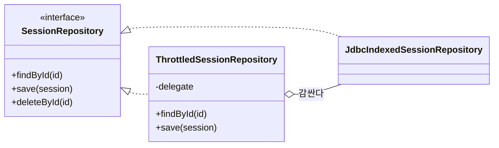
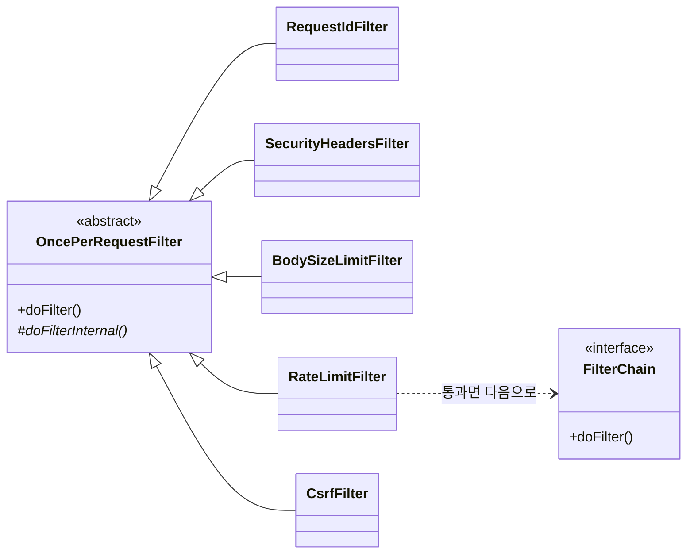
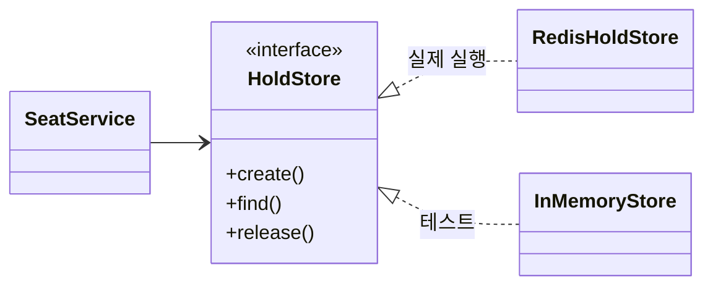

# 9. 디자인 패턴

디자인 패턴은 클래스 몇 개를 어떤 모양으로 짜는가에 대한 것이다. 이 코드에 실제로 쓰인 것을 종류별로 본다.

먼저 GoF(책 '디자인 패턴'의 23가지) 가운데 쓰인 것, 다음에 GoF에는 없지만 서버 코드에서 흔한 것, 마지막으로 React 쪽 패턴 순서다.

## GoF 패턴

| 패턴 | 분류 | 코드에서 | 왜 |
|---|---|---|---|
| 전략 | 행위 | 서비스가 인터페이스만 알고 구현을 바꿔 끼운다. `PasswordEncoder`(BCrypt), `QueueStore`와 `HoldStore`(Redis 구현 / 테스트의 `InMemoryStore`), `Transactions`. `VenueLayout`은 enum 상수마다 `exists()`를 다르게 구현한다 | 같은 일을 하는 방법이 여럿일 때 호출하는 쪽을 고치지 않고 바꾼다 |
| 템플릿 메서드 | 행위 | 필터 5개가 `OncePerRequestFilter`를 상속해 `doFilterInternal`만 쓴다 | '요청마다 한 번만 실행'은 부모가 보장한다. 자식은 할 일만 적는다 |
| 책임 연쇄 | 행위 | 필터들이 `chain.doFilter()`로 다음 필터에 넘기거나, 넘기지 않고 직접 오류로 답한다 | 검사를 하나씩 떼어 순서대로 세운다. 하나를 빼거나 넣기 쉽다 |
| 장식자 | 구조 | `ThrottledSessionRepository`가 Spring의 `JdbcIndexedSessionRepository`를 감싼다. 같은 인터페이스를 구현하고 대부분은 그대로 넘긴다 | 남의 클래스를 고치지 않고 동작을 더한다(1분 안의 연속 요청은 세션 표에 쓰지 않기) |
| 어댑터 | 구조 | `JdbcShowRepository`가 SQL 결과를 우리 인터페이스 모양으로 맞춘다. `CurrentUserResolver`는 Spring이 요구하는 인터페이스에 우리 로그인 확인을 끼운다 | 모양이 다른 두 쪽을 이어 준다 |
| 퍼사드 | 구조 | 프론트의 `api.ts`. 백엔드의 `SessionAuth`(세션 다루기를 `login`, `logout`, `userId` 몇 개로 줄임) | 복잡한 것을 창구 하나로 가린다 |
| 관찰자 | 행위 | `api.ts`의 `onAuthState`, `onUnauthenticated`에 `AuthProvider`가 처리기를 등록한다 | `api.ts`가 React를 몰라도 로그인 상태가 바뀐 것을 알릴 수 있다 |
| 싱글턴 | 생성 | 직접 만든 것은 없다. Spring이 `@Service`, `@Repository`, `@Component` 클래스를 하나씩만 만들어 나눠 준다 | 서비스와 저장소는 상태가 없어서 하나면 된다 |
| 팩터리 메서드에 가까운 것 | 생성 | 정적 팩터리 `ReservationView.of(...)`, `SaleStatus.ofPerformance(...)`, `ApiError.of(...)`. 설정 클래스의 `@Bean` 메서드 | 만드는 규칙에 이름을 붙이고 한곳에 둔다 |

세 가지를 그림으로 보면 이렇다.

장식자. 둘 다 같은 인터페이스를 구현하므로 Spring Session은 감싼 것인지 모르고 쓴다.

템플릿 메서드와 책임 연쇄. 부모의 doFilter가 틀이고, 자식은 doFilterInternal만 채운다. 그 안에서 다음 필터로 넘길지 정한다.

전략. SeatService는 어느 구현이 들어왔는지 모른다. 실행할 때는 Redis 구현이, 단위 테스트에서는 메모리 구현이 들어온다.

## GoF 밖의 서버 쪽 패턴

| 패턴 | 코드에서 | 왜 |
|---|---|---|
| 의존성 주입 | 모든 서비스가 필요한 것을 생성자로 받는다 | 전략 패턴의 구현을 누가 골라 넣을지를 Spring에 맡긴다 |
| 저장소(Repository) | `@Repository` 클래스 10개. 인터페이스는 `findPriced`, `markSold`처럼 하는 일로 이름 붙였다 | SQL을 한 클래스에 가둔다 |
| 서비스 계층 | `@Service` 클래스 7개 | 규칙과 트랜잭션 범위를 한곳에 둔다 |
| DTO, 값 객체 | `record` 78개. 요청(`HoldRequest`), 응답(`ReservationView`), DB의 줄(`ShowRow`) | 층 사이에 오가는 자료의 모양을 고정하고 바꾸지 못하게 한다 |
| 행 매퍼 | SQL 결과 한 줄을 `record`로 바꾸는 람다 13곳 | ORM 없이 표와 객체를 잇는다 |
| 프런트 컨트롤러 | Spring의 `DispatcherServlet`이 모든 요청을 받아 컨트롤러 메서드로 나눠 준다 | 틀이 제공한다. 주소와 메서드를 `@GetMapping`으로 잇기만 한다 |
| 예외 번역을 한곳에서 | `GlobalExceptionHandler`(`@RestControllerAdvice`)와 `ErrorCode` | 오류 응답의 모양을 하나로 맞춘다 |
| 결과 타입 | `HoldStore.Result`, `IdempotencyStore.Claim` (sealed interface) | 흔한 실패를 예외가 아니라 값으로 돌려준다 |
| 실행 감싸기 | `tx.inTransaction(() -> { ... })`. 안에서는 Spring의 `TransactionTemplate`을 쓴다 | 시작, 커밋, 되돌리기를 한곳에 두고 범위는 호출하는 쪽이 정한다 |

## 동시에 오는 요청을 다루는 패턴

| 패턴 | 코드에서 | 왜 |
|---|---|---|
| 낙관적 동시성(조건부 갱신) | `UPDATE seats ... WHERE status = 'AVAILABLE'` 뒤 바뀐 줄 수 확인 | 잠그지 않고도 같은 좌석이 두 번 팔리지 않는다 |
| 비관적 잠금 | `SELECT ... FOR UPDATE`로 회원 줄을 잠근다 | 한 사람의 동시 확정을 한 줄로 세운다 |
| 임대(만료가 있는 잠금) | 선점 표시에 300초 만료 | 잡고 떠난 사람의 좌석이 저절로 풀린다 |
| 멱등 키 | `Idempotency-Key`와 `IdempotencyStore` | 같은 확정이 두 번 와도 예매는 한 건이다 |
| 요청 수 제한(고정 창) | `RateLimitFilter`와 `rate-limit.lua` | 한 IP가 1분에 보낼 수 있는 수를 묶는다 |
| 차단기 | `RedisBackoff` | Redis가 실패하면 잠깐은 부르지 않는다 |
| 동기화 토큰 | `CsrfFilter` | 다른 사이트의 가짜 요청을 막는다 |

## React 쪽 패턴

| 패턴 | 코드에서 | 왜 |
|---|---|---|
| 공급자(Context) | 4개. `AuthProvider`, `ToastProvider`, `PageMetaProvider`, `BookingChromeProvider` | 여러 화면이 쓰는 값을 인자로 일일이 넘기지 않는다 |
| 커스텀 훅 | 16개. `useResource`, `usePoller`, `useAuth`, `useShowList` 등 | 받아 오기, 반복 호출, 취소를 한 번만 쓴다 |
| 화면과 조각 나누기 | `pages`가 데이터를 받아 오고 `components`는 받은 값을 그린다(대체로) | 조각을 여러 화면에서 다시 쓴다 |
| 렌더 프롭 | `MoreGrid`가 `render={(s) => ...}`로 카드 그리는 법을 받는다 | '20개씩 더 보기'는 한 번만 쓰고 무엇을 그릴지는 쓰는 쪽이 정한다 |
| 길목 지키기 | `RequireAuth`가 예매 화면과 내 예매를 감싼다 | 로그인 확인을 화면마다 쓰지 않는다 |
| 합집합 타입으로 상태 표현 | `Load<T>`는 `loading`, `ready`, `error` 중 하나 | 말이 안 되는 상태 조합을 타입이 막는다 |

> **가장 많이 기대는 것은 전략(인터페이스 뒤의 구현 바꿔 끼우기)과 의존성 주입이다. 나머지는 필터, 세션, 오류처럼 특정 자리의 문제를 푸는 데 쓰였다.**

---

[← 8. 아키텍처 패턴](08-arch-patterns.md) · [차례](README.md) · [10. 코드 읽는 순서 →](10-reading.md)
